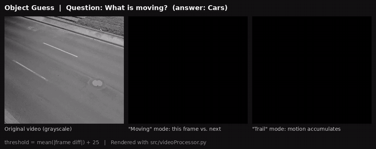
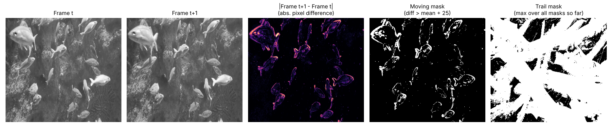
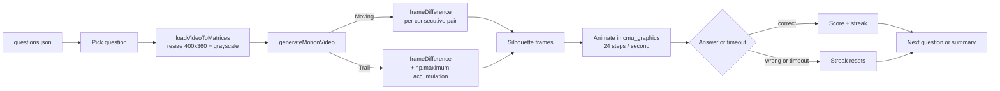
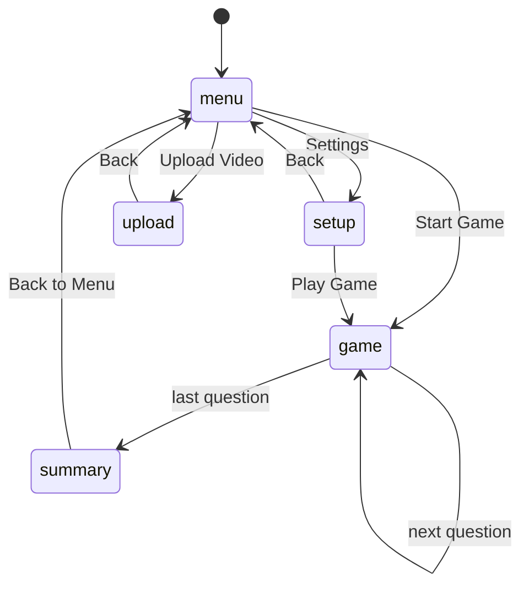
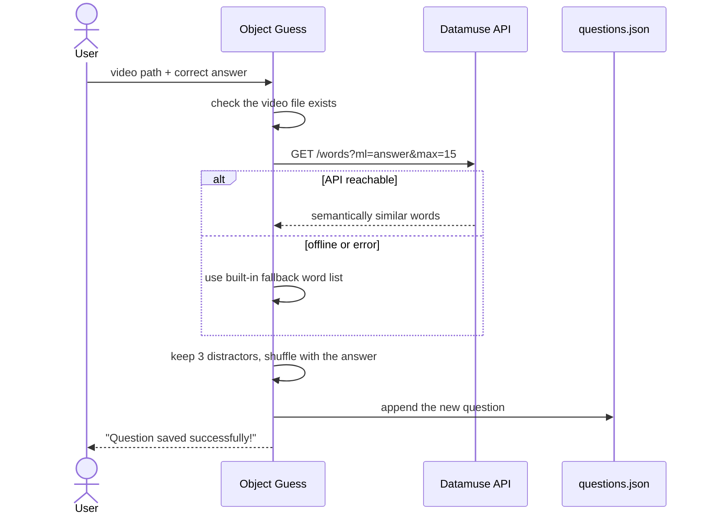

# Object Guess: Motion-Based Object Recognition Game

A desktop quiz game in Python where you identify an object from nothing but its **motion silhouette**. Each video is converted, frame by frame, into a black-and-white mask of whatever moved, so the object's shape has to be recognized from motion alone.

> Placed **3rd of ~150 students** at the CMU 15-112 (Fundamentals of Programming & Computer Science) Term Project Showcase.



*Rendered by the game's own `src/videoProcessor.py` on three of the bundled clips. A full-quality version is in [`docs/demo.mp4`](docs/demo.mp4).*

---

## Summary

Object Guess plays a short video as a silhouette of its moving pixels and asks "What is moving?". You answer by multiple choice or by typing, against a 30-second timer, and the game tracks your score and best answer streak. Anyone can grow the question bank by uploading a video and its answer, and the game generates plausible wrong answers automatically.

## Extended Summary

Each video goes through the same pipeline:

1. **Load** the video with OpenCV, resize each frame to 400 x 360, and convert it to a grayscale NumPy matrix.
2. **Difference** each pair of consecutive frames. Pixels whose brightness changed by more than a threshold become white; everything else becomes black.
3. **Mode** decides what you see:
   - **Moving**: one mask per frame pair, so only what is moving *right now* is visible.
   - **Trail**: masks are accumulated with `np.maximum`, so the path of the object stays on screen and its shape is "painted" over time.
4. **Play** the masks back as an animation inside a [`cmu_graphics`](https://academy.cs.cmu.edu/desktop) window at 24 steps per second.



*One real frame pair from `fishvid.mp4`, shown through each stage of the pipeline.*

## Requirements

| Package | Used for |
|---|---|
| Python 3 | Runtime |
| `numpy` | Frame matrices, differencing, trail accumulation |
| `opencv-python` | Reading video, resizing, grayscale conversion |
| `Pillow` | Converting masks to images |
| `cmu_graphics` | Window, drawing, and animation loop |

An internet connection is optional. It is only used to generate wrong answers for new questions; a built-in word list is used when offline.

## Installation

```bash
git clone https://github.com/woojook/motion-recognition-game-.git
cd motion-recognition-game-
pip install numpy opencv-python Pillow cmu-graphics
```

## Examples

Run the game from the repository root:

```bash
python src/main.py
```

**Playing**

1. Choose **Settings** to pick the answer style and the view.
2. Choose **Start Game**.
3. Watch the silhouette and answer before the timer runs out.

**Adding your own question**

1. Put your video in `assets/videos/`.
2. Choose **Upload Video** from the main menu.
3. Enter the video path (for example `assets/videos/myvid.mp4`) and the correct answer (for example `Cat`).
4. Choose **Save Question**. The question is appended to `src/questions.json`.

## Parameters

**Game settings** (Settings screen)

| Name | Values | Description |
|---|---|---|
| Mode | `Multiple Choice`, `Free Response` | Pick from four options, or type the answer (case-insensitive). |
| Difficulty | `Moving`, `Trail` | Full-motion silhouette, or an accumulating motion trail. |

**Processing parameters** (`src/videoProcessor.py`)

| Name | Default | Description |
|---|---|---|
| `targetWidth`, `targetHeight` | 400, 360 | Frame size used while playing. |
| `threshold` / `margin` | 25 | Sensitivity added on top of the average frame-to-frame difference. |

**Question schema** (`src/questions.json`)

```json
{
  "question": 3,
  "videoPath": "assets/videos/fishvid.mp4",
  "correctAnswer": "Fish",
  "options": ["Shlemiel", "Sucker", "Gull", "Fish"]
}
```

## Returns

When the last question is answered, a summary screen shows each question marked correct or incorrect, the **final score** (`correct / total`), and your **best answer streak**. A timeout counts as an incorrect answer and resets the streak.

## How It Works

### Processing pipeline



### Screens



### Adding a question



### Frame differencing in NumPy

```python
diff = np.abs(frame1.astype(np.int16) - frame2.astype(np.int16))
threshold = np.mean(diff) + margin          # adapts to each frame pair
mask = np.where(diff > threshold, 255, 0).astype(np.uint8)
```

Frames are cast to `int16` first so that subtracting two `uint8` images cannot wrap around. For Trail mode, the running mask is `np.maximum(accumulated, mask)`.

## Notes

- **Grayscale on purpose.** Color is removed so that only brightness change, that is motion, carries information.
- **Adaptive threshold.** The threshold is the mean frame difference plus a margin, so it adapts to each pair of frames. This helps with brightness drift, but it also makes the threshold scene-dependent (see Limitations).
- **Distractors are meaning-based.** Wrong answers come from the Datamuse "means like" query, so for "Fish" you see words related in meaning rather than random nouns.
- **Answers are normalized.** Free-response answers are trimmed and compared case-insensitively.
- **Options are shuffled** every time a question loads.

## Limitations

- The adaptive threshold in `frameDifference` is noted in the code as not working as intended. On clips with camera motion (such as `carvid.mp4`), most of the frame is flagged as moving and Trail mode saturates to white quickly. The earlier fixed-threshold version is kept as a comment for comparison.
- Videos are resized to 400 x 360, which slightly distorts the aspect ratio of 16:9 footage.
- The silhouette plays on a loop with no audio.

## Project Layout

```
.
├── assets/
│   └── videos/            # bundled sample clips
├── docs/                  # demo video and figures used in this README
└── src/
    ├── main.py            # game screens, input, scoring, uploads
    ├── videoProcessor.py  # video loading and motion masks (NumPy + OpenCV)
    └── questions.json     # question bank (video, options, answer)
```

## Credits

- Videos are from [Pexels](https://www.pexels.com) or the author's own camera roll.
- Wrong-answer generation uses the [Datamuse API](https://www.datamuse.com/api/).
- Built with [`cmu_graphics`](https://academy.cs.cmu.edu/desktop) for CMU 15-112.

## References

1. Datamuse API documentation: <https://www.datamuse.com/api/>
2. OpenCV `VideoCapture`: <https://docs.opencv.org/4.x/d8/dfe/classcv_1_1VideoCapture.html>
3. Python `urllib.request`: <https://docs.python.org/3/library/urllib.request.html>

## Author

Woojoo Kim, Carnegie Mellon University.
